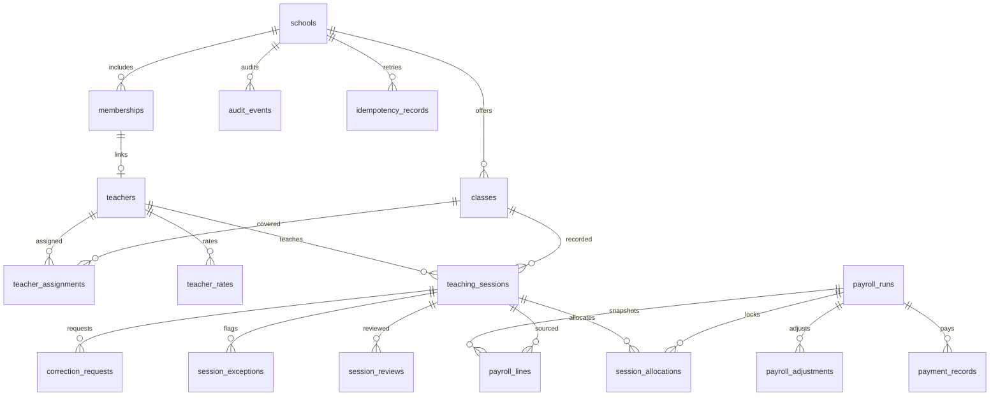

# SayaSync implementation baseline

The owner requested implementation on 22 October 2026. The supplied English and Myanmar migration plans select **Next.js App Router, TypeScript, compiled Tailwind, Supabase, and Netlify**. This supersedes the backend v1 draft's HTML/Vite/Vercel technology choices. Its business and security requirements remain the baseline. There is no existing application or hosting configuration in this checkout to migrate.

This is a working foundation, not a completed payroll product or production release. Document statements that their creation did not authorize coding describe the documents' original status; the owner's subsequent request authorizes local implementation. Hosted service creation, paid plans, remote pushes, and deployment are separate steps.

## Scope and source gaps

- Single school pilot; Admin and Teacher roles; invitation-only real access.
- Fictional public demo is independent of real authentication and database data.
- Product PRD v0.3 is now supplied and preserved in `docs/reference/Ai14_EduControl_PRD03_MM.md`. AT01–AT32 and fixture summaries are available; the original prototype, complete 12-session sample dataset, and Backend PRD v2.0 remain unavailable. The supplied backend is v1.0. See `ACCEPTANCE.md` for coverage; do not claim UI parity or full acceptance coverage.
- Use the supplied v1 notes approving whole-minute floor, session-level half-up MMK rounding, Asia/Yangon, and local start-date period attribution for the development implementation. Confirm these against the final product PRD before pilot.
- No automatic missing-checkout duration, six-hour exception, tax, partial payment, bank transfer execution, or offline sync.
- No void after any historical payment, including fully reversed payments, per the explicit pilot decision.
- Early arrival, breaks, overtime, cancellation, cutoff, recovery channel, organization owner, Supabase region/plan, production domain, retention, and backup targets still need final policy/service configuration. Do not invent production values.

## Delivery order and current state

| Stage | Deliverable | State / exit gate |
|---|---|---|
| A | Source inventory, route map, ERD, permissions, regression plan | Baseline below; original prototype pending; AT cases mapped |
| B | Next.js/React/TypeScript/Tailwind, local server, Netlify build config | Implemented locally; hosted preview not deployed |
| C | Fictional UI for records, holds, directory, payroll preparation; authenticated capture/review forms | Working exploration demo; parity awaiting prototype |
| D | Versioned database schema, default-deny writes, ownership RLS | Versioned migrations and PGlite/PostgreSQL 17 concurrency tests; not applied to hosted Supabase |
| E | Auth foundation | SSR password login, fixed callback, fresh identity + active membership checks; invitation, recovery, rate limiting, session refresh, and deactivation administration still required |
| F | Teaching workflow | Capture, correction request/review/withdrawal, Admin entry, exception resolution and verification RPCs plus authenticated workspace forms implemented; local PostgreSQL concurrency tests pass; hosted Auth/UI integration validation pending |
| G | Payroll | Authoritative draft/recalculation, adjustments, approval/allocation, full payment, reversal and unpaid void RPCs, history guards and Admin/Teacher screens implemented; local financial/concurrency tests pass; hosted migration/UI validation pending |
| H | Staging/UAT | Requires development Supabase project, original fixture details, full acceptance/security/concurrency tests, restore drill, owner sign-off |
| I | Production | Requires separate project, configuration review, release/rollback plan and deployment authorization |

## Screens and routes

| Route / proposed route | Audience | Purpose |
|---|---|---|
| `/` | Public | Product identity and demo/school entry |
| `/demo` | Public | Fictional overview, records, payroll eligibility, directory; state resets on reload |
| `/login` | Invited users | Real sign-in; disabled when Supabase is not configured |
| `/auth/callback` | Auth flow | PKCE code exchange; fixed internal destination |
| `/workspace` | Active member | Authenticated capture/review workspace; financial actions at `/workspace/payroll` after migration 005 |
| `/workspace/records` | Teacher/Admin | Planned assignment/check-in, own records / school review |
| `/workspace/corrections` | Teacher/Admin | Planned requests / review with expected version |
| `/workspace/payroll` | Admin | Draft, holds, adjustments, approval, manual payments and reversals |
| `/workspace/payments` | Teacher | Own approved breakdown and payment/reversal history via `/workspace/payroll` |
| `/workspace/settings` | Admin | Planned teachers, classes, assignments, rates, invitations |
| `/workspace/audit` | Admin | Planned school audit; teacher history via sanitized owned entities |

## Data model

UUID composite school/entity foreign keys prevent cross-school references. Partial unique indexes enforce one open session, pending correction, active allocation, and active payment. Rates use non-overlapping half-open intervals with a teacher-row lock. Exact duplicates are rejected; general overlaps must become reviewable flags, not blanket rejects, when the review service is implemented.

Allocated session updates/deletes are blocked by a trigger. Migration 005 guards approved financial snapshots, payment history and audit, with default-deny raw financial writes. Current authenticated clients have no raw table write grants. Schema presence does not implement a business workflow.

## Permission matrix

| Capability | Admin (active, own school) | Teacher (active, owned profile) |
|---|---|---|
| Teachers/classes/rates/assignments | Read; management RPCs pending | Own profile/assignments, assigned classes; rates only in approved payroll |
| Sessions | Read school sessions; Admin entry/verification RPCs | Read own; capture/correction RPCs |
| Corrections/reviews | Read school data; correction review/exception resolution RPCs | Read own requests/reviews/flags; request and withdraw owned corrections |
| Draft runs/lines/adjustments | Read | Denied |
| Approved lines/adjustments | Read | Own breakdown only; no aggregate run totals |
| Payments | Read; fixed full-payment and reversal RPCs | Own approved run payments only |
| Audit/idempotency | Admin read | Denied raw access; sanitized own history pending |
| Direct writes | Denied | Denied |

Every future server operation must independently check fresh identity, active membership, role and ownership. Use normal cookie-bound clients for ordinary reads. Authorize invitations before using any privileged client. Never trust a browser role, school or amount. Never grant future functions implicit PUBLIC execution. Sensitive reads must remain dynamic and private.

## Transaction contract for remaining work

Use teacher parent-row locks consistently for rate, assignment, session, correction, and payroll source changes; lock multiple teachers in UUID order, then affected rows in stable order. Approval must revalidate source versions, effective rate, policy version, assignment, pending corrections, unresolved exceptions, and allocation eligibility under that same lock protocol. Persist snapshots, allocations, status, idempotency response, and audit in one transaction. Payment uses frozen teacher net, not an amount from the browser. Reversal retains the original payment and requires a reason. Negative net rejects approval. No write API should ship before its concurrency/security tests.

## Validation and release checklist

- [x] Calculation examples: 65 min × 12,000 = 13,000; 50 + 1 min × 10,000 = 8,333 + 167; minute floor; half-up boundary; invalid inputs.
- [x] Initial migrations execute in local PostgreSQL engine (PGlite).
- [x] Teacher-to-teacher read isolation; direct privilege escalation denied; deactivated membership denied despite token identity.
- [x] Capture retries, changed checkout retry conflict, one-open-session guard, ownership enforcement, transactional audit.
- [ ] Hosted Supabase Auth integration, invitation, recovery, logout/session refresh and deactivation revocation.
- [x] Separate-connection capture/correction/review races under isolated PostgreSQL 17. Hosted Supabase validation and exhaustive school-boundary tests remain pending.
- [x] Local correction/review/withdrawal, exception resolution, Admin self-review, original-time preservation, lock guards and audit rollback tests.
- [ ] Hosted review/payroll UI integration and migration 005 validation. Local stale-draft, immutable snapshot, allocation, payment/reversal and payment-history Void guards now pass.
- [ ] Exact original 12-session fixture integration. Aggregate teacher totals and correction increments are now tested separately; do not manufacture missing session rows.
- [ ] Full AT01–AT32 integration, original UI parity, accessible forms/dialogs and mobile checks.
- [ ] Performance targets (proposed): 100 teachers, 20,000 sessions/year, 10 concurrent users; p95 list <2s, calculation of 5,000 sessions <10s.
- [ ] Netlify preview with development database, production CSP and origin/rate-limit review, recovery redirects, security/cookie checks.
- [ ] Backup restore with financial/audit consistency; decide RPO/RTO/retention based on service plan.
- [ ] Two-cycle parallel pilot and owner/Admin/Teacher sign-off.

## Environment separation and rollback

Use a new development Supabase project and separate production project. Configure preview contexts with development variables only. Disable public signup in Auth and configure invitation/recovery redirect allowlists for confirmed domains. Do not apply development SQL to an existing database without inspecting it. Seed only fictional data. Migrations are source-controlled but none have been applied remotely.

For staging: apply migrations in order, securely bootstrap the initial owner membership using administrative tooling, configure public project URL/publishable key, and run RLS/API/end-to-end tests. No secret/service-role key belongs in `NEXT_PUBLIC_*`. Privileged invitation credentials are not needed for the present foundation.

For release: record prior Netlify deployment, take/verify backup, apply reviewed additive migrations and deploy a tagged build. If application rollback is needed, redeploy the known-good frontend while preserving database compatibility. Treat database recovery as a separate reviewed procedure; never automatically drop tables or reset a project. Do not release with wrong payroll, data leakage, duplicate financial writes, or an untested restore.

Payroll implementation and new migration details: [PAYROLL_WORKFLOW.md](PAYROLL_WORKFLOW.md). The original four migrations were applied by the owner; run only the new 005 migration for this increment.

## Prototype increment superseding earlier gap notes

The supplied ZIP now provides the original design and full twelve-session snapshot. See [PROTOTYPE_ALIGNMENT.md](PROTOTYPE_ALIGNMENT.md) for completed UI/master-data/capture alignment, exact fixture tests and remaining hosted checks. The owner previously applied 001–005; only 006 is new. Earlier missing-prototype and missing-fixture notes above describe the state before this upload.
